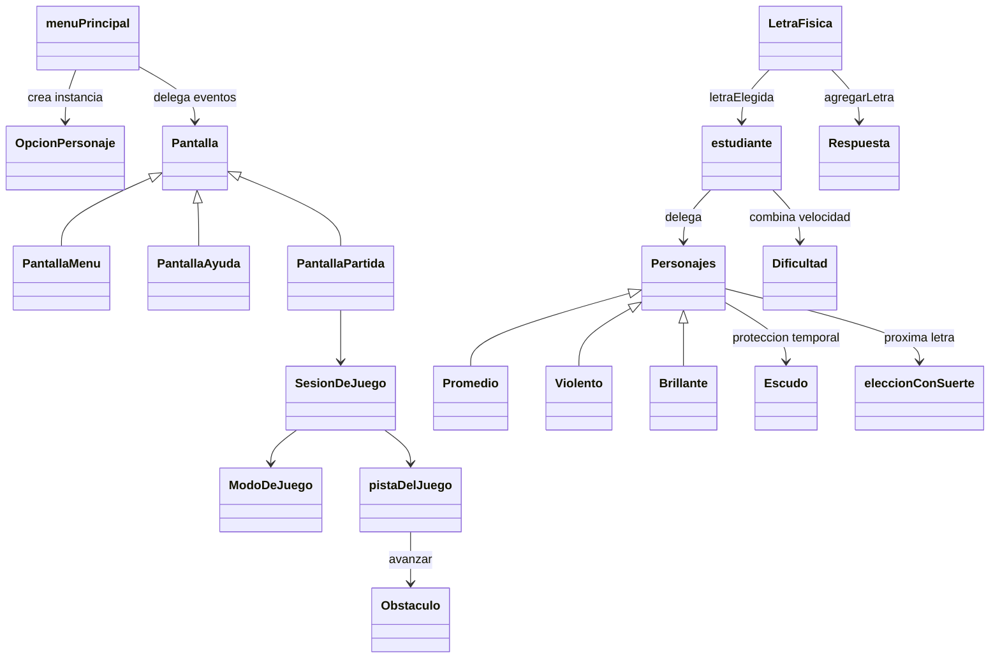

# Explicaciones teóricas — Checkpoint 2

## Herencia y estado encapsulado

`Personajes` (`personajes.wlk`) concentra carril, concentración, velocidad base de
obstáculos, uso de habilidad, protección y elección de letras. Sus atributos son
privados. `Promedio`, `Violento` y `Brillante` heredan movimiento y recuperación.
Violento redefine daño y habilidad; Brillante redefine habilidad. Cada subclase
configura la velocidad heredada. Se crean instancias nuevas al comenzar una partida.

`estudiante` conserva la identidad registrada en Wollok Game y delega en el personaje
elegido: no pregunta si es Violento o Brillante. Además combina su velocidad con
la dificultad, y conserva la presentación de derrota existente.

## Polimorfismo

- Todos los personajes reciben `activarHabilidad()`. Promedio no hace nada;
  Violento activa Suerte y Brillante activa Enfoque.
- `vulnerable` y `Escudo` entienden `recibirGolpe(personaje)` y `avanzar(ms, personaje)`.
  La protección decide si aplica daño, sin condicionales por tipo de personaje.
- `eleccionNormal` y `eleccionConSuerte` entienden `elegir(letra, respuesta, personaje)`.
  Suerte devuelve la siguiente letra esperada y se consume.
- Los elementos siguen recibiendo `serChocadoPor(estudiante)`: cada uno aplica su efecto.
- `PantallaMenu`, `PantallaAyuda` y `PantallaPartida` atienden el mismo protocolo de
  teclado. En partida, los modos existentes separan recorrido, zona segura,
  escritura y final. F escribe normalmente en el modo de escritura.
- Los carriles conservan el polimorfismo de límites: el vecino del borde es él mismo.

## Tiempo y dificultad

La velocidad se expresa en celdas por segundo. Promedio: 2.5; Violento: 3.33;
Brillante: 1.67. Fácil multiplica por 0.75, Normal por 1 y Difícil por 1.25.
La frecuencia de generación usa `1400 / factor` milisegundos.
Cada obstáculo acumula el desplazamiento y baja una celda al completar una unidad;
con el tick de 200 ms y estas velocidades nunca salta una celda de colisión.

La sesión tiene un solo reloj. Menú, ayuda, escritura y fin no avanzan la pista
ni el escudo. Enfoque dura 5000 ms de juego activo. Las habilidades se usan **una
vez por partida**, sin recarga. Suerte espera la siguiente letra física; se
consume aunque esa letra ya fuera la correcta. Una nueva partida restablece todo.

Durante 30 segundos hay distracciones. Luego se limpian y aparecen tres opciones
en una zona segura de hasta 5 segundos. Elegir una consume la tanda. Las letras
incorrectas se ignoran; las respuestas escritas incorrectas tampoco penalizan.
Completar las letras resuelve sin puntos; acertar por escrito da 100 por letra.

## Diagrama de clases y colaboraciones

## Validación

`tests/checkpoint2.wtest` cubre daño polimórfico, vidas no negativas, uso único,
consumo de Suerte, duración exacta del escudo, velocidades, dificultad, colisiones,
ayuda, selección, F durante escritura, pausa y reinicio. Se conservan los tests
de movimiento, colisiones y respuestas del primer checkpoint.

Los tres personajes reutilizan `assets/estudiante.png`; la elección y el estado
de la habilidad se identifican por texto. Café y apuntes conservan su protocolo
de colisión, pero no se generan durante este ciclo; aún faltan sus imágenes.
