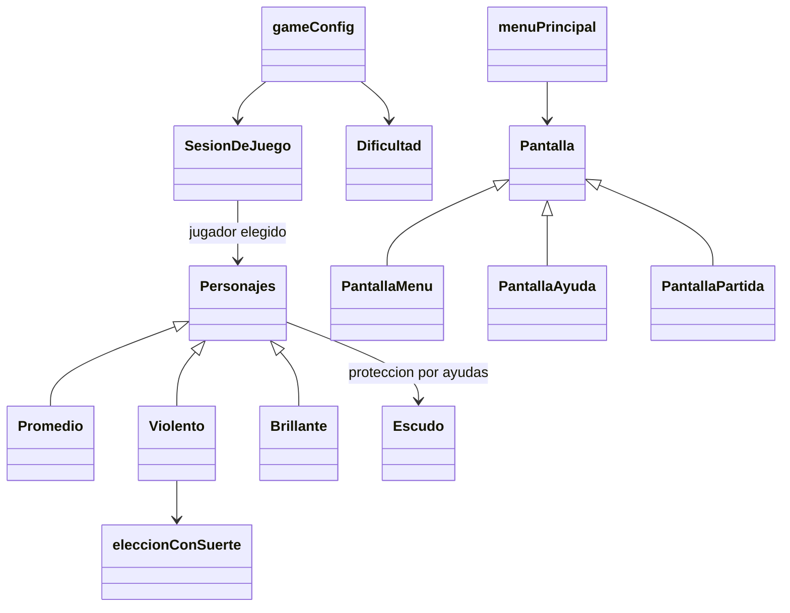

# Diseño orientado a objetos — Checkpoint 2

## Un personaje, una instancia

`Personajes` es la superclase abstracta de `Promedio`, `Violento` y `Brillante`.
Contiene carril, vidas, velocidad y protección. Cada subclase debe definir
`nombre()`, `danioPorDistraccion()` y `usarHabilidad()`.

El antiguo objeto `estudiante` fue eliminado: duplicaba la interfaz del personaje
mediante delegaciones. `SesionDeJuego` conserva directamente la instancia elegida.
`gameConfig.jugador()` permite consultarla desde los visuales y la pista.
El jugador dibujado, el receptor de colisiones y el dueño de las vidas son el
mismo objeto. Al elegir otro personaje se retira el visual anterior y se elimina
su manejador de colisiones antes de registrar el nuevo.

La dificultad pertenece a la configuración de la partida. La presentación de
Game Over pertenece al modo sin vidas, no al personaje.

## Habilidades en las subclases

El único método de habilidad declarado en `Personajes` es `usarHabilidad()`:

- `Promedio` lo implementa sin efecto. No tiene variables de habilidad utilizada
  ni métodos para consultar Suerte.
- `Violento` administra su uso único y la letra asegurada. Solo esta clase entiende
  `tieneSuerte()`, `consumirSuerte()` y `letraElegida(...)`.
- `Brillante` administra el uso único de Enfoque y activa la protección común.

Los textos de habilidad los implementa cada subclase. La base no decide cuáles
estados de habilidad existen ni conoce sus nombres.

Todas las letras envían `recogerLetra(letra, respuesta)` al personaje. La base
entrega la letra a la respuesta; Violento redefine ese mensaje para aplicar
Suerte antes de entregarla. No se consulta el tipo del personaje.

## Por qué el escudo sí es común

Apuntes puede dar un escudo a cualquiera de los tres personajes. Por eso
`activarEscudo()`, `tieneEscudo()` y el avance de su duración permanecen en la
superclase. El escudo recibido como ayuda no consume la habilidad propia.
`vulnerable` y `Escudo` deciden polimórficamente si un golpe descuenta vida.

## Pantallas y controles

`Pantalla` no declara mensajes para las flechas. `PantallaMenu` implementa las
cuatro direcciones, mientras que `PantallaPartida` solo implementa izquierda y
derecha. `PantallaAyuda` hereda directamente de `Pantalla` y no recibe mensajes
de movimiento. `menuPrincipal` despacha las flechas según la pantalla activa:

- En el menú cambian personaje y dificultad.
- En la ayuda no producen efectos.
- En partida cambian de carril mediante la sesión, que los ignora al escribir
  una respuesta o cuando termina la partida.

Los manejadores de teclado se registran una vez y envían las flechas a
`menuPrincipal`, que solo reenvía cada dirección a las pantallas que la manejan.

## Diagrama

## Verificación

Los tests comprueban escudo para todos los personajes, uso único, letras,
reinicio, teclado con el motor iniciado y colisiones sobre la instancia elegida.

Persiste el fallo de dificultad ya detectado: la velocidad se multiplica por
1.5 en Fácil y por 0.75 en Difícil, mientras el test espera el orden inverso.
Esta reorganización conserva los factores actuales.
